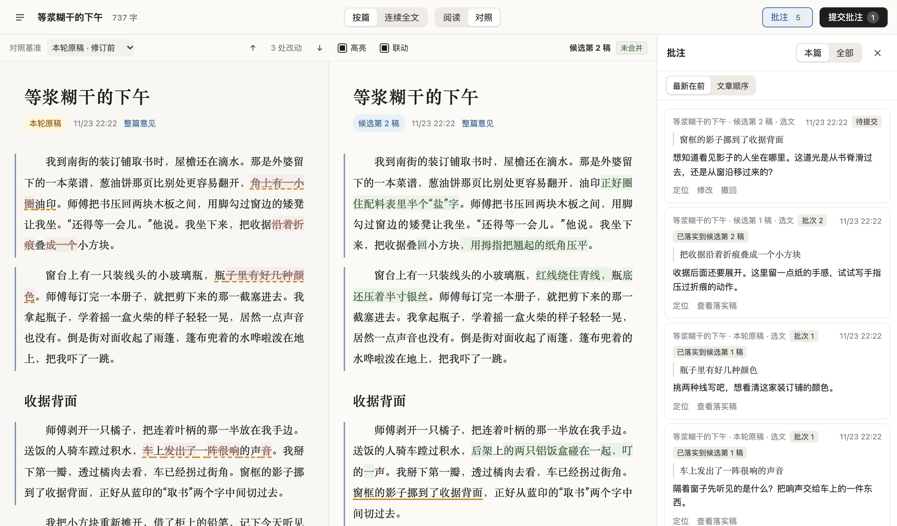
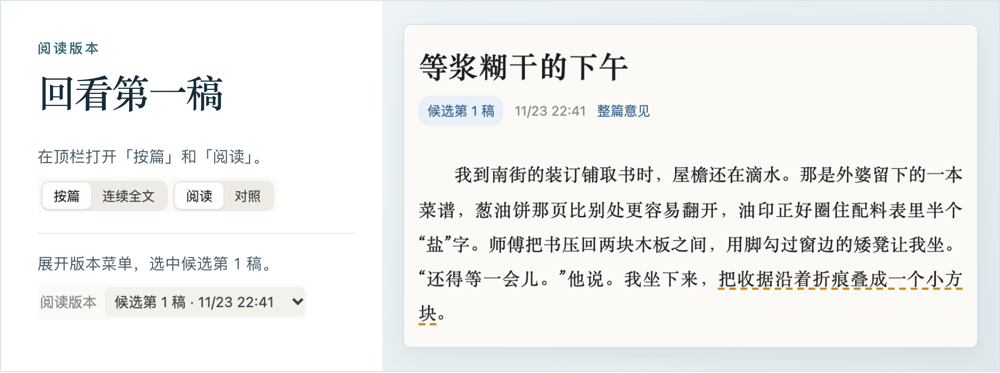
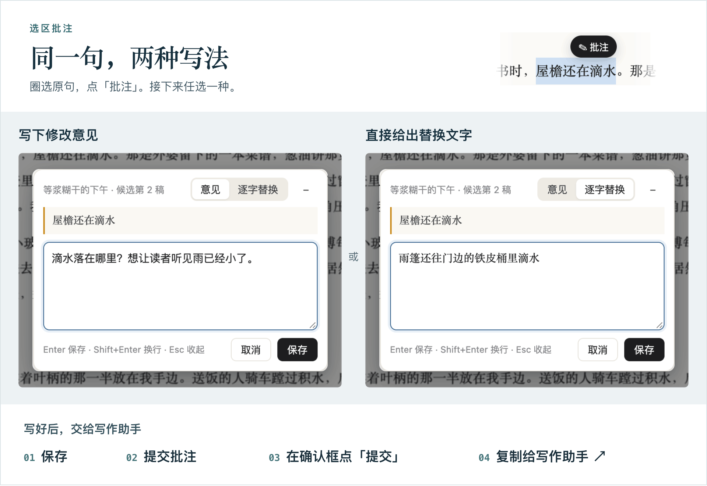

**对稿**是给作者和写作助手共用的本地审阅台。选中「屋檐还在滴水」，你可以问「水落在哪里？」，也可以直接写好想换上的那句话。助手把修改放进独立的候选稿，你并排读两版，再决定哪些文字可以定稿。

**提交批注只会生成交接批次。** 你可以来回修五稿，也可以第二稿就先定下这一篇。只有你明确指定文稿和稿次，让 agent 执行合并，才会写入正式文件。

[先试示例](#先试示例) · [接入自己的文稿](#接入自己的文稿) · [如何使用 · 看图上手](#如何使用)



## 先试示例

下载并**解压**整个仓库。建议先打开随附的散文《等浆糊干的下午》，里面已经准备好两份候选稿和几条批注，可以马上切换基准、试写意见。示例与自己的书稿分开保存。[下载 ZIP](https://github.com/SSSimpleC/draftpair/releases/latest/download/DraftPair.zip) · [版本发布](https://github.com/SSSimpleC/draftpair/releases/latest)

| 系统 | 第一次怎么打开 |
| --- | --- |
| **Windows** | 安装 Python 3.9 或更高版本，启用 Python 启动器或将 Python 加入 PATH。在解压后的目录双击 **Open DraftPair.cmd**，会自动准备环境并打开浏览器。 |
| **macOS** | 准备好 Python 3.9 或更高版本，双击 **打开对稿.command**。想放在 Dock 上，可用 Xcode Command Line Tools 运行 `./macos/build-app.sh`，将生成的「对稿.app」拖入 Dock。App 与启动脚本放在一起。 |
| **Linux** | 在工具目录运行下方三行命令。最后一步启动本机服务，并在浏览器打开示例。 |

```sh
python3 -m venv .venv
.venv/bin/python -m pip install -r requirements.txt
.venv/bin/python launch.py --demo
```

首次安装 Python 依赖需要联网，平时阅读、批注和看候选稿都在本机进行。随附的 Markdown 示例可以直接打开。正式合并需要 Git，Windows 可安装 [Git for Windows](https://gitforwindows.org/)。[Python 下载](https://www.python.org/downloads/)

## 接入自己的文稿

在**能访问你文稿目录和终端**的写作 agent 里打开项目，将下面这段话发给它。它可以依据书稿目录、LaTeX 入口或项目自己的约定完成接入。

```text
请把 https://github.com/SSSimpleC/draftpair 接入我当前的写作项目。
按仓库 AGENTS.md 识别正文、阅读顺序和原有构建方式，保持我的目录结构和正式文件原样。
在副本验证批注和候选稿对照。接好以后，给我本机打开地址，并设好下次双击的入口。
```

| 你写的东西 | 对稿如何接入 |
| --- | --- |
| Markdown 随笔、长文、手册 | 直接读原文件，可按目录清单或指定顺序串成全文，保留标题、表格和本地插图。 |
| LaTeX 论文、书稿 | 识别常见的 `\input`、`\include` 顺序，批注定位到实际的 `.tex`。有 Pandoc 时可预览公式等内容，复杂宏可直接对源码提意见，成稿仍由原项目排版。 |
| Quarto book | 沿用 `_quarto.yml` 中的章节、附录和引用。也可保留原生 Quarto 预览，同时指定自己的检查命令与输出文件。 |
| 纯文本、剧本或团队自定义格式 | UTF-8 文本可以按段直接审阅。若有自己的场景标记、说话人或段落结构，让 agent 实现小型适配器，返回带原文件行号的预览块。 |

接入清单只负责告诉工具「读哪些文件、怎么读」。同一个项目可以有 Markdown 序章、LaTeX 正文和文本手记。Word 文件、扫描件和现成 PDF 需要另行准备可定位的文本源。适配器与构建脚本在自己的电脑上执行，适合登记你和 agent 核对过的项目脚本。[适配协议与完整示例](docs/adapters.md) · [给 agent 的接入与交接步骤](AGENTS.md)

<details>
<summary>自己从终端接入</summary>

在工具目录运行。先预览将要登记的文件，再按所需顺序生成清单。`doctor` 会读取真实正文，检查预览和行号映射，列出构建配置。

**macOS 和 Linux**

```sh
.venv/bin/python review.py --root "/path/to/manuscript" init --dry-run
.venv/bin/python review.py --root "/path/to/manuscript" init "序章.md" "正文/第一篇.md"
.venv/bin/python review.py --root "/path/to/manuscript" doctor
.venv/bin/python launch.py --root "/path/to/manuscript" --remember
```

**Windows PowerShell**（首次双击启动器后）

```powershell
.\.venv\Scripts\python.exe review.py --root "D:\我的书稿" init --dry-run
.\.venv\Scripts\python.exe review.py --root "D:\我的书稿" init "序章.md" "正文/第一篇.md"
.\.venv\Scripts\python.exe review.py --root "D:\我的书稿" doctor
& ".\Open DraftPair.cmd" --root "D:\我的书稿" --remember
```

已有 Quarto book 可以跳过生成清单。已有 `draftpair.json` 时直接调整其中的顺序。`--remember` 将双击入口指向这份书稿。随时可用 `--demo` 打开示例。

</details>

## 第一次使用时

**我在这里写的内容会发给谁？** 对稿在浏览器里连接本机服务，无需注册、API Key 或绑定模型。「复制给写作助手」只把交接路径和指令放进剪贴板。由你决定在哪个 agent 里粘贴，也由那个 agent 的权限和服务设置决定它能读取或发送什么。如果用的是无法访问本机文件的聊天模型，可以请本地 agent 整理相关选文和批注，让模型按编号返回局部改写，再由本地 agent 拼成候选稿。

**关掉网页之后还在吗？** 已保存的意见、提交批次、候选版本和历史图片都在文稿目录的 `.draftpair/`。备份或迁移时，把这个隐藏目录和文稿一起带走。旧版项目会继续使用已有的 `.qmd-margin/`。关闭标签页后，本机服务可供下次复用。要结束它，在工具目录运行启动器并加 `--stop`，也可用 `launch.py --root <文稿目录> --stop` 指定项目。

**我还可以在原来的编辑器里写吗？** 可以。切回或刷新审阅页会重新读取磁盘正文。第一次保存该篇批注时，对稿会固定一份「本轮原稿」，以后还能看清总共改了什么。合并时会一并比较这份原稿、你选的候选和磁盘现稿。各改各处会保留双方的改动，同一处发生冲突时，agent 可以把具体分歧拿回来让你决定。

**有备份吗？必须写完整本才能定稿吗？** 每次正式合并前都会保存该篇的写入前副本、原稿、候选和合并结果，位于审阅数据的 `merges/` 中。可以先定一篇或一个阶段，其他篇继续改。若一份候选里只有部分修改适合落盘，先让 agent 出一份只含已认可改动的候选。归档后仍能在阅读版本菜单里找到历史稿。

对稿按 [MIT 许可证](LICENSE) 发布。

## 如何使用

打开示例《等浆糊干的下午》，可以跟着下面三张图走一遍。自己的新文稿从阅读开始，写作助手发布第一份候选稿后就能打开对照。

### 阅读时，怎么知道眼前是哪一稿？

<picture>
  <source media="(max-width: 620px)" srcset="docs/guide-reading-mobile.png">
  
</picture>

- **找一篇、读一稿。** 左上角的目录可以跳到篇名或小标题。在「阅读版本」中选一稿，正文标题下的版签会显示你实际打开的版本。即使目录提示已有第 2 稿，你也能回看第 1 稿。
- **从头通读。** 点「连续全文」。选「工作稿」会串起各篇最新候选，没有候选的篇目沿用正式稿。选「正式稿」可以通读磁盘上的原文。
- **边读边看批注。** 右上角打开「批注」，点一条就能回到它引用的原句。默认最新在前，切到「文章顺序」后还可打开「跟随正文」，让右栏随你读到的位置滚动。

### 对照时，第二稿究竟动了哪一句？

<picture>
  <source media="(max-width: 620px)" srcset="docs/guide-compare-mobile.png">
  
</picture>

**右边是本篇最新候选，左边由你选基准。** 默认左边的「本轮原稿 · 修订前」是本轮第一次保存批注时固定的正文，用它可以看累计改动。从第 2 稿起，选「上一稿」就能只看这一次。图里收据的动作从「把收据沿着折痕叠成一个小方块」改成了「把收据叠回小方块，用拇指把翘起的纸角压平」。右栏的「未合并」表示这句话还在候选里。

用上下箭头跳到前后两处改动。「高亮」标出左边删去、右边加入的字，「联动」使两栏同时滚到对应段落。窄窗可以点版本按钮切换左右稿。两边都能选中批注，想找回删掉的原话，就在左边圈住那句写「恢复这句」。

### 圈一句话，交给写作助手

<picture>
  <source media="(max-width: 620px)" srcset="docs/guide-annotation-mobile.png">
  
</picture>

选中原句，点旁边浮出的「批注」。可以只圈一个标点，也能圈连续几段。图、表、单元格、题注和整篇文稿也各有批注入口。同一句话可以用两种方式提出修改，**任选一种**。

| 你的想法 | 在批注框里怎么写 |
| --- | --- |
| 想让助手斟酌 | 选「意见」，例如“滴水落在哪里？想让读者听见雨已经小了。” |
| 已经想好原句怎么改 | 选「逐字替换」。输入框会预填选文，直接改成“雨篷还往门边的铁皮桶里滴水”。清空表示删除所选文字。 |

1. **保存这一条。** 按 **Enter** 保存，**Shift+Enter** 换行。按 **Esc** 收起草稿，之后可以在批注栏里续写。浮窗挡住正文时，可按住顶部留白拖开。
2. **核对并提交这一批。** 顶栏点「提交批注」，在确认框看清引自哪一稿、圈了哪句话和要求改到哪一稿，再点「提交」。确认前可修改或撤回。提交后想补充，可以再圈同一处说明。
3. **让助手出候选稿。** 点成功提示或批注栏里的「复制给写作助手」，把交接文字粘贴到能访问文稿的 agent 对话中。它能从本机路径找到各批尚未处理的意见。已经接入同一项目时，也可以这么说。

> 处理对稿里最新提交的批注，按各篇当前父稿逐条修改。请发布候选稿，告诉我回到哪一篇看对照。正式文件等我确认后再合并。

切回审阅页或刷新，打开「对照」。还想再改，就在新候选上继续批注。**提交批注、发布候选都保存在审阅数据里。** 等一篇或一个阶段定下来，再明确告诉助手要写回哪篇、哪一稿。

> 把《等浆糊干的下午》的候选第 2 稿合并到正式文件。先核对磁盘上另做的修改，若同一处有冲突，把两种文字列出来给我选。其他篇继续修订。
